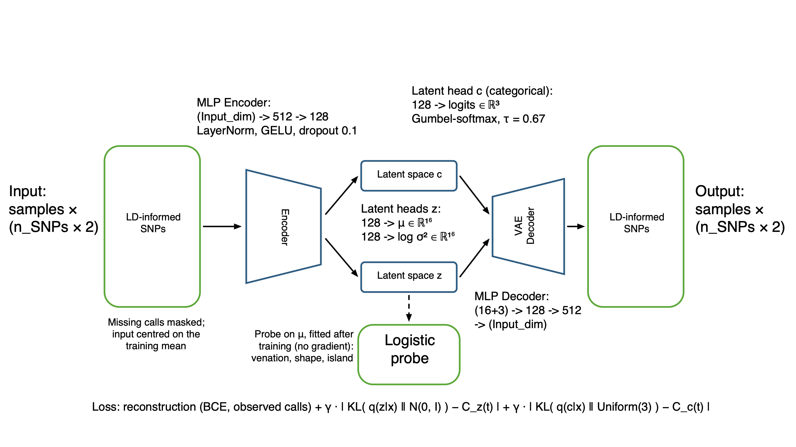
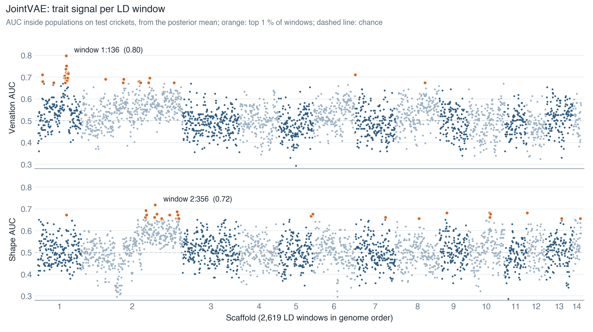

# JointVAE for Crickets dataset

PyTorch JointVAE for cricket SNP data: an unsupervised VAE with a Gaussian latent `z` and a
categorical latent `c`, one model per LD window.



## Install

From the repository root, create and activate the Conda environment.

```bash
conda env create -n jointvae -f environment.yml
conda activate jointvae
```

## Run

Set the dataset paths, code paths, and Conda setup in the Slurm scripts for your cluster. Create the log directory specified in `#SBATCH --output` and `#SBATCH --error` before submitting.

### Train all LD blocks

```bash
sbatch run_cricket_all_block.sh
```

This runs five-fold cross-validation for each LD block across scaffolds 1–14, with the same folds as [CAD_VAE_CRICKET](https://github.com/Ziyang-cyber/CAD_VAE_CRICKET).

### Run ablation studies

Select a training job and submit the plotting job after the matching runs finish.

| Experiment | Train | Plot |
| --- | --- | --- |
| Weight and capacity of `z` | `sbatch run_cricket_capacity.sh` | `sbatch run_plot_cricket_ablation.sh` |
| Low weight, high capacity | `sbatch run_cricket_capacity_high.sh` | `sbatch run_plot_cricket_ablation.sh` |
| Number of categories | `sbatch run_cricket_k.sh` | `sbatch run_plot_cricket_ablation.sh` |
| Marginal-prior weight | `sbatch run_cricket_marginal.sh` | `sbatch run_plot_cricket_ablation.sh` |

## Results


